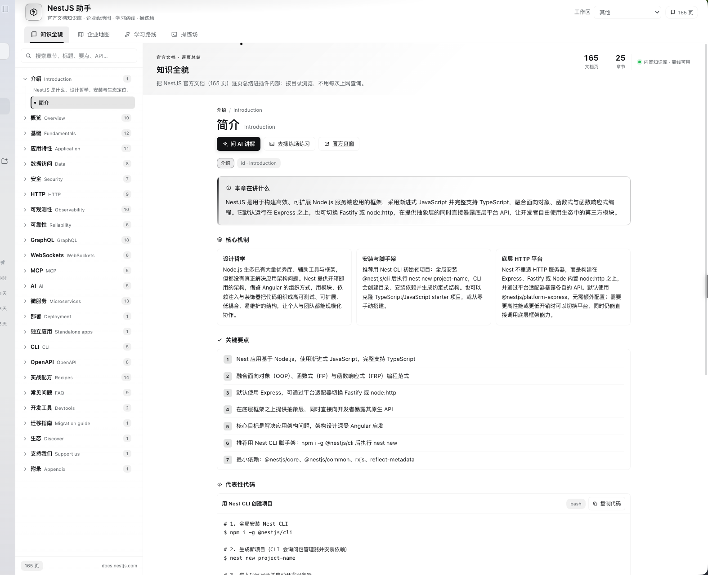
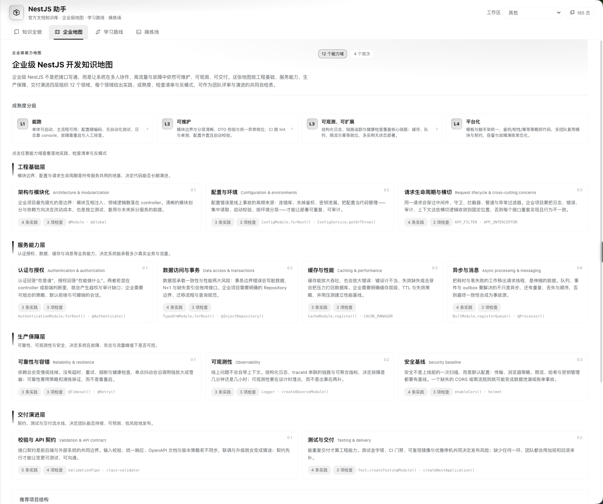
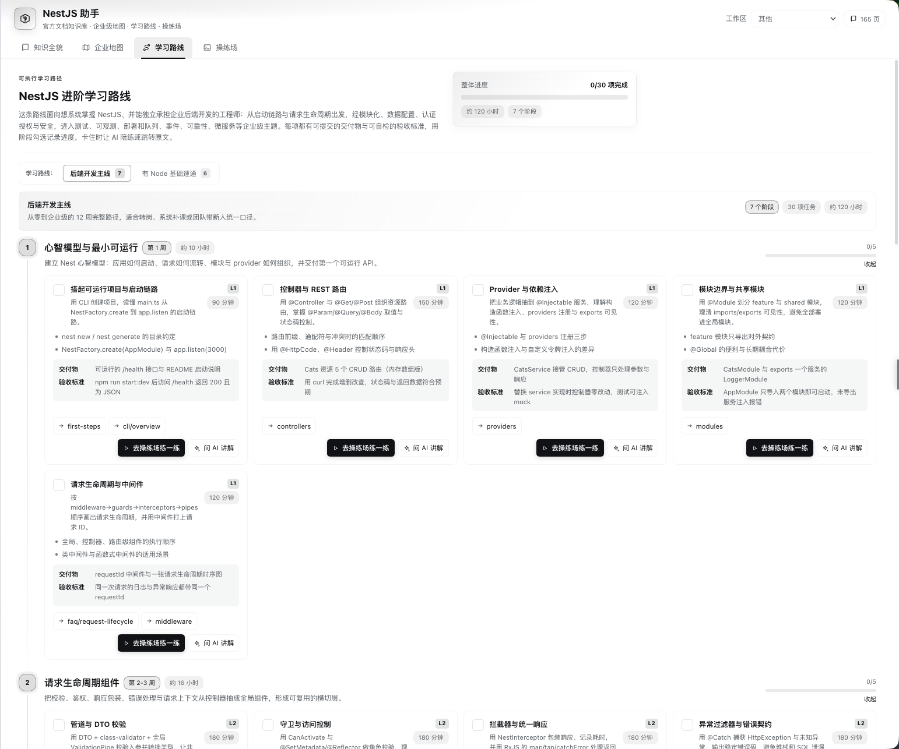
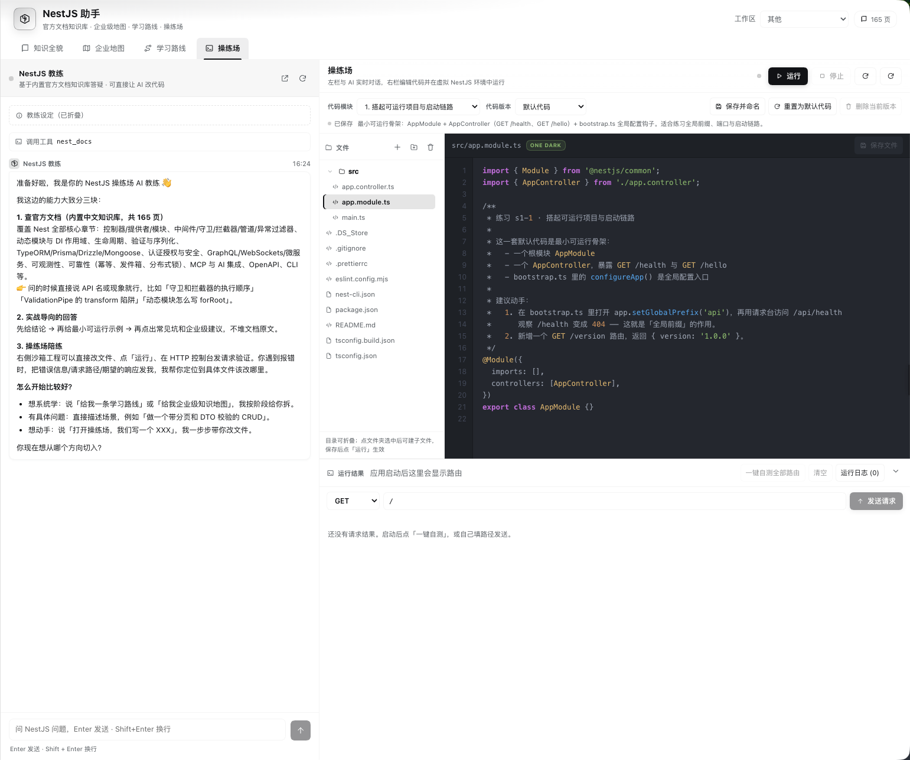

# NestJS 助手（@local/nest-assistant）— DSH Web UI 插件

## 安装

前提：**DeepSeek Harness ≥ 0.2.2**（桌面版 / 网页版均可），能访问 GitHub（或用镜像/代理）。

从 GitHub 安装（推荐固定 tag）：

```
github:lniev/nestjs-assistant#v1.0.1
```

- **Web UI**：左侧栏「插件」→「安装第三方插件」→ 粘贴上面的地址 → 安装；
- **让 AI 装**：让会话执行 `plugin_manager` 的 `install_bundle`，`target` 填上面的地址；
- **CLI**：`dsh plugin --profile <profile> add github:lniev/nestjs-assistant#v1.0.1`。

安装后打开侧边栏「NestJS 助手」。升级方式：先卸载再用新 tag 安装。完整发布/安装/排错说明见
[PUBLISHING.md](PUBLISHING.md)。

> 插件以你的本机权限运行，请只安装可信来源。

## 界面截图

| 知识全貌 | 企业地图 |
| --- | --- |
|  |  |
| **知识全貌**：165 页官方文档逐页中文总结，目录树 + 搜索 + 一键跳原文 | **企业地图**：12 个能力域、L1–L4 成熟度、实践 / 检查清单 / 反模式 |

| 学习路线 | 操练场 |
| --- | --- |
|  |  |
| **学习路线**：7 阶段 30 个练习，可勾选进度、一键去操练场 | **操练场**：代码模块 + 版本保存 + 真实 NestJS 运行时 + AI 教练 |


把 **NestJS 官方文档全量（165 页）** 逐页总结进插件内部，并提供：

| Tab | 内容 |
| --- | --- |
| 知识全貌 | 官方文档目录树 + 每页中文总结（核心机制、关键要点、代码片段、API、常见坑、企业建议），支持搜索与「问 AI 讲解」 |
| 企业地图 | 企业级 NestJS 开发知识地图：分层领域、L1–L4 成熟度、最佳实践、上线检查清单、反模式、关键 Nest API、推荐项目结构 |
| 学习路线 | 分阶段学习路线：每项有目标、要点、交付物、验收标准、时长、关联文档页，可勾选进度 |
| 操练场 | 左右两栏：左侧与 AI 教练实时对话（真实 DSH 会话），右侧是**代码模块栏 + 缩进式文件树**（文件夹可折叠、可手动新建文件/文件夹、可删除）与代码编辑器。**每个学习路线练习都有自己的一套可运行默认代码**（31 个模块：s1-1 … s7-4 + 自由沙盒），默认工程就是**真实 Nest CLI 脚手架形态**（`src/main.ts` 入口、package.json 真实脚本与依赖、nest-cli.json、tsconfig.build.json、README 等，文件树里可直接看到/编辑），可编辑、**保存并命名**成该模块的多个代码版本、随时切换/重置，切换时自动停止正在运行的应用；启动**虚拟 NestJS 运行环境**、一键自测路由 / 手动发请求并查看响应与日志（**运行结果面板可折叠**）；左侧 AI 对话内容**完整渲染 Markdown**（GFM 表格、分隔线、列表、粗体/行内代码），代码块使用与编辑器一致的 **One Dark 语法高亮** |

## 操练场代码模块（本轮新增）

- **模块**：`playground-modules/<moduleId>/module.json` + `default/`（一套可编译可运行的 NestJS 工程）。
  已内置 31 个模块：学习路线 30 个练习（s1-1 … s7-4，含 goal/practice/默认代码）+ 自由沙盒 sandbox（最初的 Cats 示例）。
- **切换模块**：右侧「代码模块」栏选择模块 → 工作区文件整体替换为该模块的代码，正在运行的应用先被停止。
- **代码版本**：编辑后点「保存并命名」→ 当前工作区保存为该模块的一份代码版本（同一模块可多份），
  版本下拉可随时切回；「重置为默认代码」恢复该模块的默认工程；「删除当前版本」删除正在使用的那份（先切回默认）。
- **学习路线联动**：学习路线每个练习卡片上有「去操练场练一练」，点击直接跳到操练场并选中对应模块。
- **持久化**：`playground-state.json`（当前模块/版本/脏标记）、`playground-saves/<moduleId>/<snapshotId>/`（保存的版本）。
- `node scripts/upgrade-module-scaffold.mjs` 可把模块默认工程重新升级为真实脚手架形态（幂等，执行后跑 `node scripts/verify-modules.mjs`）。
  这两者是运行时生成物，删除后会回到默认状态（自由沙盒）。

Host 半另外注册：

- `nest_docs` 工具（search / read / list / map / route）——让 AI 直接查询内置知识库，不必每次上网查官方文档；
- 系统提示片段，说明知识库与操练场的用法；
- 同源 HTTP API `/nest-assistant/api/*`（知识库、沙箱文件、运行/请求/停止）；
- `host/playground-runtime.js`：用预装 TypeScript 编译沙箱 TS 文件 → 用内置 Node 启动真实 Nest 应用 → 代理 HTTP 请求。

## 目录

```
index.js                     Host 半：知识库加载、nest_docs 工具、API 路由、运行时管理
client.js                    Client 半（build.mjs 生成）
build.mjs                    把 src/**/*.js 拼装成 client.js
src/00-dicts.js              基础字典
src/01-utils.js              共享工具（fetch/storage/富文本）
src/02-glyphs.js             图标
src/03-chat.js               教练会话（真实 DSH 会话的数据流与聊天窗格）
src/04-styles-base.js        基础样式（主题 token）
src/views/*.js               四个视图
src/styles/*.js              各视图样式
src/panel.js                 面板外壳与 Tab
src/apply.js                 注册 main 面板 + 侧栏入口 + 字典
host/playground-runtime.js   虚拟 NestJS 运行时（编译/启动/请求 + 工作区整体替换 replaceFrom/captureTo）
host/playground-projects.js  代码模块 / 代码版本存储层（切换、保存、重置、状态文件）
host/playground-template/    自由沙盒的初始示例工程
playground-modules/          31 个代码模块（module.json + default/ 可运行工程）
playground-state.json        运行时生成：当前模块/版本/脏标记（可删除）
playground-saves/            运行时生成：保存的代码版本
knowledge/_index.json        官方文档页面清单（由 docs 仓库生成）
knowledge/parts/*.json       每个官方页面的中文总结（多 agent 并行生成）
knowledge/enterprise-map.json 企业级知识地图数据
knowledge/learning-route.json 学习路线数据
knowledge/data.json          合并后的运行时知识库（build-data.mjs 生成）
scripts/build-data.mjs       合并/校验知识库
scripts/smoke.mjs            离线冒烟测试
```

## 覆盖与验证

- 知识库覆盖 NestJS 官方文档仓库 `content/` 下 **全部 165 个 Markdown 页面**，逐页生成中文总结
  （摘要 / 核心机制 / 关键要点 / 代码片段 / API / 常见坑 / 企业建议 / 相关页面），并保留官方文档 URL。
- 离线验证脚本：
  - `node scripts/verify-modules.mjs` — **逐个真实编译 + 启动 + 请求**每个代码模块的默认工程（`--list` / `--only=` / `--stage=` / `--jobs=`）；
    当前 31/31 PASS；
  - `node host/playground-projects.test.mjs` — 代码模块/版本存储层单测（切换、保存、加载、删除、重置、状态文件、路径校验）；
  - `node scripts/seed-modules.mjs` — 从 `knowledge/learning-route.json` 补齐 `playground-modules/*/module.json` 元数据（幂等）；
  - `node scripts/smoke.mjs` — 知识库完整性 + 企业地图/学习路线引用 + Client bundle 契约/视图渲染（含模块栏）；
  - `node scripts/test-host-api.mjs` — 用假 Cordis 上下文驱动 Host 半，验证 `/kb`、`nest_docs` 工具、沙箱文件 API、
    模块/版本 API（切换前停止运行）、运行/请求/停止的全链路（会真实编译并启动 Nest 应用，并在结束时恢复原状态）；
  - `node host/playground-runtime.test.mjs` — 虚拟 NestJS 运行时直测（初始化/编译/启动/代理请求/编译错误/重置）。

## 开发

```bash
node build.mjs              # 生成 client.js（src/ → client.js）
node scripts/build-data.mjs # 合并 knowledge/parts/*.json → knowledge/data.json
node scripts/smoke.mjs      # 离线校验
```

安装（plugin_manager）：`install_bundle`，target 为插件目录绝对路径。
卸载：`remove_bundle`，target 为 `@local/nest-assistant`。
